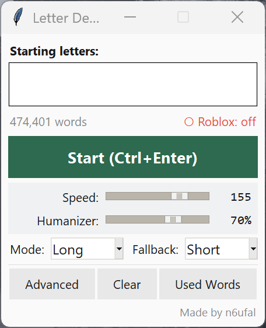

+++
title = "What Happens When You Take a Word Game Too Seriously"
date = 2026-05-16
draft = false
+++

There's a word game on Roblox called Last Letter. The premise is simple: you sit at a table with two or four players, someone types a word, and the next person continues from the last letter — or last few letters. The overlap grows as rounds progress, from one letter up to four. Meanwhile, the timer shrinks: fifteen seconds at first, then down to five. Lose a heart when you can't keep up.

In the first round it's just one letter — someone plays _apple_, you continue from _e_, so you play _eagle_. Second round the overlap lengthens: _eagle_ ends in _le_, so the next word has to start with _le_ — say, _levy_. Third round, _levy_ ends in _vy_, so the next word starts with _vy_ — they answered with _vying_. Now you're in round four, inheriting the last three letters: _ing_.

It sounds manageable. It isn't.

## The "Dummkopf" Incident

I'm an English Literature graduate, which sounds like an advantage in a word game. It isn't — not for this one. Literature rewards depth. Last Letter rewards a very specific kind of vocabulary: words that end in letter combinations nobody else is prepared for. Loanwords. Taxonomic names. Obscure coinages from languages English absorbed quietly and mostly forgot about.

I stumbled into that realization the way most things click: through humiliation, then curiosity.

I was playing normally when I typed _dummkopf_ in a round four match — German for "dumb head," the kind of word you pick up from old war films and never expect to use in a Roblox game. I half-expected the game to reject it. It didn't. It accepted the word and handed my opponent the suffix _pf_ to start their next word with.

Try thinking of an English word that starts with _pf_. Take your time. The consonant cluster barely fits in English mouths — it's the kind of thing that makes linguists sigh. There's _pfft_, which is less a word and more a transcribed noise. And there's _pfennig_, a former German coin, which the game also accepts. That's essentially it. I had accidentally constructed a near-perfect trap without understanding what I'd done.

So I started doing it on purpose.

_Kuvasz_ — a Hungarian dog breed — sailed through the dictionary and left my opponent with _sz_. The answer to that is _Szekkler_, a variant spelling of the Székely people of Transylvania. _Yangtze_ hands over _tze_. Three-letter rounds opened up stranger territory: _tzi_, _dae_, _mni_, and a long tail of loan and taxonomy-sourced endings that basically required your opponent to have studied obscure etymology for fun.

Four-letter rounds got worse. Greek suffixes like _odon_ and _opod_ — borrowed from paleontological taxonomies — force opponents into a corner. Find a word starting with _odon_. Without preparation, most people can't.

Some of these are findable in standard dictionaries if you dig. What surprised me was the other direction: where the game's vocabulary came from that _wasn't_ in anything I'd checked.

I'd been testing words against public references — Merriam-Webster, Wiktionary, spelling bee dictionaries — trying to map the edges of what the game knew. Most of the time the pattern held.

Then I found _okshoofd_.

It's a unit of liquid measurement. Wiktionary traces it back to Middle Dutch _ocxhooft_ in 1475 — a partial calque of the Middle English _hoggeshed_. It doesn't appear in standard Merriam-Webster. It's not in any spelling bee list I'd seen. It exists, practically speaking, almost exclusively as a Wiktionary entry for a word nobody has used in centuries.

The game accepted it.

More importantly: _okshoofd_ ends in _fd_. I went looking for words that start with _fd_ and found _transfd_ — a non-standard abbreviation of _transferred_, buried in Merriam-Webster's abbreviations appendix. The game accepted that too.

Which opened a whole other door. The game accepts abbreviations. _Bkcy_ for bankruptcy. _Bkgd_ for background. Meaning that if you play _yrbk_ (yearbook) or _nabk_ (a type of tree), your opponent inherits _bk_ — and the answer is a bankruptcy abbreviation. The game is perfectly fine with this.

At that point I stopped being surprised and started being systematic.

The game's dictionary is large. Somewhere north of 480,000 words — Merriam-Webster Unabridged territory, not the roughly 200,000-word collegiate edition most people mean when they say "Merriam-Webster." But it's not exactly the Unabridged either. Some entries the Unabridged has, the game rejects. Some things the game accepts I couldn't source anywhere obvious. And since MW Unabridged isn't open-source, it couldn't be the direct source anyway.

The closest match I found was [dwyl/english-words](https://github.com/dwyl/english-words) — a plain text file of 479,000 English words, maintained on GitHub, no paywall. Jackpot.

## Clever for About an Hour

The first version of what became Letter Demon was embarrassingly simple: a Python lookup tool with a bare-bones window, an input field, a button, and a list of results. Type a prefix, get every matching word.


 It worked, but it was slow in a way that mattered. Scanning half a million words one by one adds up fast when you're racing a five-second timer. So I rebuilt the lookup using **binary search** — the same idea as flipping through a physical dictionary. Open somewhere in the middle, see if you've gone too far, cut the remaining space in half. Repeat until you land.

```python
def search_starts(words, query):
    # words is already sorted: ["apple", "apricot", "banana", ...]
    lo = bisect.bisect_left(words, query)              # First match
    hi = bisect.bisect_right(words, query + '\uffff')  # Last match — '\uffff' sorts after any real character, making it a clean upper boundary
    return words[lo:hi]
```

Instead of checking all 479,000 entries, the search makes about 38 comparisons total. Instant.

Suffix search turned out almost as clean, once I stopped overthinking it. Reverse every word in the list, reverse the query, then run the same binary search:

```python
def search_ends(words_rev, query):
    rev_query = query[::-1]                            # Reverse the suffix you're looking for
    lo = bisect.bisect_left(words_rev, rev_query)
    hi = bisect.bisect_right(words_rev, rev_query + '\uffff')
    return [w[::-1] for w in words_rev[lo:hi]]        # Flip the results back before returning
```

"Ends with _ing_" becomes "starts with _gni_" on the reversed list. Same binary search, same speed. I felt clever for about an hour.

But even that wasn't enough. I was still alt-tabbing, typing prefixes manually, picking words, then typing them into Roblox. I wanted something that could just _play_ for me. So I started building what I now call Letter Demon.

## Here Comes the Demon

I named it that because "Word Assistant" was too honest.



This is corny, I know. But the 3AM version of me, half delirious, it made perfect sense.

Letter Demon doesn't suggest words — it takes the wheel, finds the nastiest ending in the dictionary, types it out with unsettling human rhythm, and waits in the corner for next round.

### The Dictionary's Soul

First real challenge: loading a 500,000-word dictionary every launch took almost a second. Fine for a script, terrible for a tool that needs to feel responsive. So I added a cache:

```python
def load_wordlist_from_dict(dict_path):
    cache_path = get_cache_path(dict_path)
    cache_hash_path = cache_path.replace('.txt', '.hash')

    # Check if a valid cache already exists before doing any real work
    if _cache_is_valid(cache_path, dict_path) and os.path.exists(cache_hash_path):
        dict_hash = _compute_file_hash(dict_path)
        if _verify_cache_hash(cache_hash_path, dict_hash):
            with open(cache_path, "r", encoding="utf-8") as f:
                wordlist = f.read().splitlines()
            return wordlist, True  # from_cache = True

    # No valid cache — parse from scratch and save one for next time
    words_set = _load_dict_file(dict_path)
    wordlist = sorted(words_set)

    with open(cache_path, "w", encoding="utf-8") as f:
        f.write("\n".join(wordlist))

    dict_hash = _compute_file_hash(dict_path)
    with open(cache_hash_path, "w") as f:
        f.write(dict_hash)

    return wordlist, False
```

Two-tier validation: a cheap timestamp check first, then a cryptographic hash only if the cache looks stale. Launch time dropped from 1 second to 50 milliseconds.

But here's the thing I almost missed. The dictionary alone is utterly useless without the **trap list**.

### The Trap List: My Secret Sauce

Letter Demon doesn't just find any word that matches the prefix. It tries to find words that end in suffixes that are _nightmares_ to continue from. That list — `trap_endings.txt` — is entirely hand-curated.

```
ocy
loh
xo
sz
tze
odon
opod
trak
...
```

Every entry represents hours of trial and error. I'd play round after round, and every time an opponent stumbled on a suffix — or every time I got stuck myself — I'd jot it down.

The longer the trap, the more devastating. In round four, your opponent has to find a word starting with all of them.

Also, the trap scoring system is dead simple:

```python
def _trap_score(self, word: str) -> int:
    lower = word.lower()
    # Walk backward through suffix lengths, longest first — longer traps score higher
    for length in range(min(len(lower), max_len), 1, -1):
        if lower[-length:] in ending_scores:
            return ending_scores[lower[-length:]]
    return 0  # No known trap suffix — this word is polite
```

A four-letter trap like `odon` is worth more than `sz`, because forcing someone to find a word starting with `odon` is statistically crueler.

When I'm in "Trap Words" mode, the engine scans every candidate, checks its ending against the trap list, and returns the nastiest one it can find. It picks randomly among the highest-scoring candidates — so I don't play the same word every time, but every word I play is engineered to hurt.

If the dictionary knows _Yangtze_ and the trap list knows `tze`, that's checkmate.

### The Human Illusion

I couldn't just use `keyboard.write()`. That types too fast, too evenly. Roblox doesn't detect it as cheating (as far as I know), but it feels unnatural — metronomic in a way humans never are. I wanted hesitation, uneven rhythm, the occasional pause between hard letter combinations.

I settled on a **log-normal distribution** for keypress delays. Human reaction times aren't uniform — they cluster around a median but occasionally spike much longer. The log-normal models that perfectly:

```python
def _next_delay(self) -> float:
    base_s = max(0.03, self.base_speed_ms / 1000.0)

    if not self.jitter_on:
        return base_s

    # scale controls the spread — higher means more variance between keypresses
    scale = (self.jitter_pct / 100.0) * 0.75
    mu = math.log(base_s)  # median delay equals base_speed_ms
    delay = random.lognormvariate(mu, scale)

    return max(0.03, delay)  # Never go below 30ms — any faster looks robotic
```

With jitter turned up to 75%, the typing looks convincingly human — sometimes hesitant, sometimes rushed, never perfectly metronomic. I watched it type "exhilarating" once and felt uncomfortable. It looked too real.

### The Window Dance

Then came the nightmare: actually typing into Roblox. I couldn't just send keystrokes to a background process. Roblox ignores them. I had to steal focus — yank the game window to the foreground, type, then hide my app again before anyone noticed.

Windows doesn't like programs that steal focus. Whole APIs exist to prevent exactly what I was doing.

So I got creative:

```python
def focus_roblox_window() -> None:
    user32 = ctypes.WinDLL("user32", use_last_error=True)  # Direct line to the Windows API
    hwnd = user32.FindWindowW(None, "Roblox")               # Find the Roblox window by title

    if hwnd:
        if user32.IsIconic(hwnd):        # Is it minimized?
            user32.ShowWindow(hwnd, 9)   # Restore it
        user32.SetForegroundWindow(hwnd) # Steal focus
```

This worked about 80% of the time. The other 20%, Windows fought back — flickering taskbar, refused focus, the game minimizing again mid-type.

Eventually I discovered the fix: hide my own window first.

```python
def on_play_round(self):
    self.root.withdraw()               # My app disappears
    focus_roblox_window()              # Nothing competing — Roblox takes focus cleanly
    self.typer.type_text(completion)   # Type the word
    self.root.deiconify()              # Come back
```

The user never sees the transition. One second they're looking at the app, then Roblox magically appears, types a word, and vanishes. It feels like possession.

### Threading Nightmares

All of this runs in the background while a small Tkinter window sits on my second monitor. But Tkinter doesn't play nice with blocking operations. Type directly on the main thread and the UI freezes solid. Skip the locks and the dictionary reloads mid-round and everything explodes.

The solution: daemon threads and reentrant locks.

```python
def on_play_round(self):
    with self._playing_lock:
        if self._is_playing:
            return  # Already typing — bail before we fire two words at once
        self._is_playing = True

    self.root.withdraw()  # Hide, focus Roblox

    # Kick off typing in a background thread so the UI stays alive
    threading.Thread(
        target=self._type_and_return,
        args=(completion,),
        daemon=True
    ).start()

def _type_and_return(self, completion):
    try:
        self.typer.type_text(completion)
    finally:
        with self._playing_lock:
            self._is_playing = False
        self.root.after(0, self.root.deiconify)  # Hand the UI restore back to the main thread
```

The `RLock` prevents deadlocks when the engine calls into itself. The `after(0)` trick is what keeps Tkinter happy — it requires that anything touching the UI happen on the main thread, and without that one line, the whole thing crashes in a way that takes an embarrassingly long time to diagnose.

I learned more about concurrency debugging this than I did from any textbook.

## What I Actually Learned

I never really noticed the moment I went from "huh, that's interesting" to "why am I still awake trying to fix this." That's just kind of how it goes when something gets stuck in your head.

None of it was serious, honestly. A slow dictionary load that probably nobody else would notice. A Roblox helper that was a little buggy. Small, silly stuff. But it bothered me, so I kept poking at it.

Along the way I kept running into ideas I'd never heard of before — things like binary search, which I had to look up, and once I understood it I genuinely couldn't believe how clever it was. That's probably the best way I can describe this whole experience, actually. A lot of "wait, that's a thing? that's so cool."

I didn't build anything impressive. I'm not a developer, I don't have a background in any of this. I'm just a hobbyist who got a little obsessed with a problem and ended up learning more than I expected. Most of it came from curiosity and stubbornness in roughly equal measure.

If you're a no-coder like me and you're thinking about diving into something like this — honestly, just start. You'll figure it out as you go. That's pretty much all I did.
