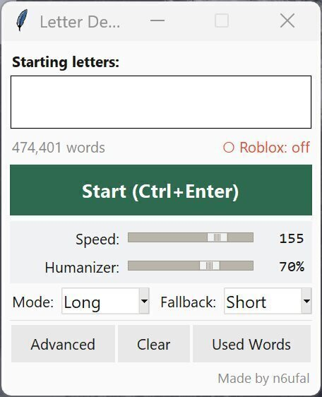

+++
title = "What Happens When You Take a Word Game Too Seriously"
date = 2026-05-16
draft = false
tags = ["code"]
+++

There’s this word game on Roblox called Last Letter. The idea is simple: you sit at a table with a few other people, someone types a word, and the next person has to start from the last letter—or the last few letters. Each round, the overlap gets longer. Round one is just one letter. Round two, two letters. Up to four letters. Meanwhile, the timer shrinks: fifteen seconds to start, then down to five. If you can’t keep up, you lose a heart.

First round, one letter: someone plays *apple*, you go from *e*, so you play *eagle*. Second round, longer overlap: *eagle* ends in *le*, so the next word has to start with *le*—like *levy*. Third round, *levy* ends in *vy*, so you need a word starting with *vy*—they answered *vying*. Now you’re in round four, inheriting the last three letters: *ing*.

Sounds manageable. It isn’t.

## The “Dummkopf” Incident

Learning the history of linguistics in college didn't teach me many practical skills, but it did teach me one thing that matters: how to look for the edges of a language. The weird exceptions. The borrowed words that never quite fit. That's what sparked something in me. I stopped trying to play Last Letter "well" and started trying to play it mean—finding endings that give the opponent nothing to work with.

I figured this out the way most things click: through *embarrassment*, then *curiosity*.

I was playing normally when I typed *dummkopf* in a round four match. German for "dumb head." The kind of word you pick up from old war movies and never expect to use in Roblox. I half-expected the game to reject it. It didn't. It accepted the word and handed my opponent the suffix *pf*.

Try thinking of an English word that starts with *pf*. Go ahead. I'll wait. The sound barely fits in an English mouth. There's *pfft*, which is more a noise than a word. And *pfennig*, an old German coin, which the game also accepts. That's basically it. I had accidentally built a perfect trap without even realizing what I'd done.

*Kuvasz* — a Hungarian dog breed — sailed through the dictionary and left my opponent with *sz*. The answer? *Szekkler*, a variant spelling of the Székely people from Transylvania. *Yangtze* hands over *tze*. Three-letter rounds opened up even stranger endings: *tzi*, *dae*, *mni* — the kind of stuff that basically requires you to have studied obscure etymology for fun.

Four-letter rounds got worse. Greek suffixes like *odon* and *opod* — borrowed from fossil names — force opponents into a corner. Find a word starting with *odon*. Without preparation, most people can't.

Some of these are findable in normal dictionaries if you dig. But what surprised me was what the game knew that *wasn't* in anything I'd checked.

I'd been testing words against public sources — Merriam-Webster, Wiktionary, spelling bee lists — trying to map the edges of the game's vocabulary. Most of the time, the pattern held.

Then I found *okshoofd*.

It's a unit of liquid measurement. Wiktionary traces it back to Middle Dutch in 1475. It's not in standard Merriam-Webster. It's not in any spelling bee list I'd seen. It exists, practically speaking, almost exclusively as a Wiktionary entry for a word nobody has used in centuries.

The game accepted it.

More importantly, *okshoofd* ends in *fd*. I went looking for words that start with *fd* and found *transfd* — a non-standard abbreviation of *transferred*, buried in Merriam-Webster's abbreviations appendix. The game accepted that too.

Which opened another door. The game accepts abbreviations (it's crazy, I know). *Bkcy* for bankruptcy. *Bkgd* for background. Meaning if you play *yrbk* (yearbook) or *nabk* (a type of tree), your opponent inherits *bk* — and the answer is a bankruptcy abbreviation.

At that point I stopped being surprised and started being systematic.

The game’s dictionary is huge. Somewhere north of 480,000 words—Merriam‑Webster Unabridged territory, not the ~200,000‑word college edition most people mean. But it’s not exactly the Unabridged either. Some things the Unabridged has, the game rejects. Some things the game accepts I couldn’t source anywhere obvious. And since MW Unabridged isn’t open‑source, it couldn’t be the direct source anyway.

The closest match I found was [dwyl/english-words](https://github.com/dwyl/english-words)—a plain text file of 479,000 English words, hosted on GitHub. Jackpot.

The next part gets technical. If you're here for the takeaway, skip ahead to [What I Actually Learned](#what-i-actually-learned).

## Clever for About an Hour

The first version of what became Letter Demon was embarrassingly simple: a Python lookup tool with a bare‑bones window, an input box, a button, and a list of results. Type a prefix, get every matching word.


It worked, but it was slow in a way that mattered. Scanning half a million words one by one takes too long when you’re racing a five‑second timer. So I rebuilt the lookup using **binary search**—the same idea as flipping through a physical dictionary. Open somewhere in the middle, see if you’ve gone too far, cut the remaining space in half. Repeat until you land.

```python
def search_starts(words, query):
    # words is already sorted: ["apple", "apricot", "banana", ...]
    lo = bisect.bisect_left(words, query)              # First match
    hi = bisect.bisect_right(words, query + '\uffff')  # Last match — '\uffff' sorts after any real character, making it a clean upper boundary
    return words[lo:hi]
```

Instead of checking all 479,000 entries, the search makes about 38 comparisons total. Instant.

Suffix search turned out almost as clean, once I stopped overthinking it. Reverse every word in the list, reverse the query, then run the same binary search:

```python
def search_ends(words_rev, query):
    rev_query = query[::-1]                            # Reverse the suffix you're looking for
    lo = bisect.bisect_left(words_rev, rev_query)
    hi = bisect.bisect_right(words_rev, rev_query + '\uffff')
    return [w[::-1] for w in words_rev[lo:hi]]        # Flip the results back before returning
```

“Ends with *ing*” becomes “starts with *gni*” on the reversed list. Same binary search, same speed. I felt clever for about an hour.

But even that wasn’t enough. I was still alt‑tabbing, typing prefixes by hand, picking words, then typing them into Roblox. I wanted something that could just *play* for me. So I started building what I now call Letter Demon.

## Here Comes the Demon

I named it that because “Word Assistant” was too honest.



This is corny, I know. But the 3AM version of me, half delirious, thought it made perfect sense.

Letter Demon doesn’t just suggest words—it takes the wheel, finds the nastiest ending in the dictionary, types it out with an unsettlingly human rhythm, and waits in the corner for the next round.

### The Dictionary’s Soul

First real problem: loading a 500,000‑word dictionary every time I launched the tool took almost a second. Fine for a script, terrible for something that needs to feel responsive. So I added a cache:

```python
def load_wordlist_from_dict(dict_path):
    cache_path = get_cache_path(dict_path)
    cache_hash_path = cache_path.replace('.txt', '.hash')

    # Check if a valid cache already exists before doing any real work
    if _cache_is_valid(cache_path, dict_path) and os.path.exists(cache_hash_path):
        dict_hash = _compute_file_hash(dict_path)
        if _verify_cache_hash(cache_hash_path, dict_hash):
            with open(cache_path, "r", encoding="utf-8") as f:
                wordlist = f.read().splitlines()
            return wordlist, True  # from_cache = True

    # No valid cache — parse from scratch and save one for next time
    words_set = _load_dict_file(dict_path)
    wordlist = sorted(words_set)

    with open(cache_path, "w", encoding="utf-8") as f:
        f.write("\n".join(wordlist))

    dict_hash = _compute_file_hash(dict_path)
    with open(cache_hash_path, "w") as f:
        f.write(dict_hash)

    return wordlist, False
```

Two checks: a quick timestamp first, then a more thorough hash only if the cache looks old. Launch time dropped from 1 second to 50 milliseconds.

But here’s the thing I almost missed. The dictionary alone is useless without the **trap list**.

### The Trap List: My Secret Sauce

Letter Demon doesn’t just find any matching word. It tries to find words that end in suffixes that are *nightmares* to continue from. That list—`trap_endings.txt`—is entirely hand‑curated.

```
ocy
loh
xo
sz
tze
odon
opod
trak
...
```

Every entry represents hours of trial and error. I’d play round after round, and every time an opponent got stuck on a suffix—or every time I got stuck myself—I’d write it down.

The longer the trap, the more devastating. In round four, your opponent has to find a word starting with all four letters.

The scoring is dead simple:

```python
def _trap_score(self, word: str) -> int:
    lower = word.lower()
    # Walk backward through suffix lengths, longest first — longer traps score higher
    for length in range(min(len(lower), max_len), 1, -1):
        if lower[-length:] in ending_scores:
            return ending_scores[lower[-length:]]
    return 0  # No known trap suffix — this word is polite
```

A four‑letter trap like `odon` is worth more than `sz`, because forcing someone to find a word starting with `odon` is statistically crueler.

When I’m in “Trap Words” mode, the engine scans every candidate, checks its ending against the trap list, and returns the nastiest one it can find. It picks randomly among the highest‑scoring candidates—so I don’t play the same word every time, but every word I play is engineered to hurt.

If the dictionary knows *Yangtze* and the trap list knows `tze`, that’s checkmate.

### The Human Illusion

I couldn’t just use `keyboard.write()`. That types too fast, too even. Though Roblox doesn’t detect it as cheating (as far as I know), but it feels unnatural—metronomic in a way humans never are. I wanted hesitation, uneven rhythm, the occasional pause between hard letter combos.

I settled on a **log‑normal distribution** for keypress delays. Human reaction times aren’t uniform—they cluster around a median but sometimes spike much longer. The log‑normal models that perfectly:

```python
def _next_delay(self) -> float:
    base_s = max(0.03, self.base_speed_ms / 1000.0)

    if not self.jitter_on:
        return base_s

    # scale controls the spread — higher means more variance between keypresses
    scale = (self.jitter_pct / 100.0) * 0.75
    mu = math.log(base_s)  # median delay equals base_speed_ms
    delay = random.lognormvariate(mu, scale)

    return max(0.03, delay)  # Never go below 30ms — any faster looks robotic
```

With jitter turned up to 75%, the typing looks convincingly human. Sometimes hesitant, sometimes rushed, never perfectly metronomic. I watched it type “exhilarating” once and felt uncomfortable. It looked too real.

### The Window Dance

Then came the nightmare: actually typing into Roblox. I couldn’t just send keystrokes to a background process. Roblox ignores them. I had to steal focus—yank the game window to the front, type, then hide my app again before anyone noticed.

Windows doesn’t like programs that steal focus. Whole APIs exist to prevent exactly what I was doing.

So I got creative:

```python
def focus_roblox_window() -> None:
    user32 = ctypes.WinDLL("user32", use_last_error=True)  # Direct line to the Windows API
    hwnd = user32.FindWindowW(None, "Roblox")               # Find the Roblox window by title

    if hwnd:
        if user32.IsIconic(hwnd):        # Is it minimized?
            user32.ShowWindow(hwnd, 9)   # Restore it
        user32.SetForegroundWindow(hwnd) # Steal focus
```

This worked about 80% of the time. The other 20%, Windows fought back—flickering taskbar, refused focus, the game minimizing again mid‑type.

Eventually I found the fix: hide my own window first.

```python
def on_play_round(self):
    self.root.withdraw()               # My app disappears
    focus_roblox_window()              # Nothing competing — Roblox takes focus cleanly
    self.typer.type_text(completion)   # Type the word
    self.root.deiconify()              # Come back
```

The user never sees the transition. One second they’re looking at the app, then Roblox magically appears, types a word, and vanishes.

### Threading Nightmares

All of this runs in the background while a small Tkinter window sits on top of the game. But Tkinter doesn’t play nice with blocking operations. Type directly on the main thread and the UI freezes solid. Skip the locks and the dictionary reloads mid‑round and everything explodes.

The solution: background threads and reentrant locks.

```python
def on_play_round(self):
    with self._playing_lock:
        if self._is_playing:
            return  # Already typing — bail before we fire two words at once
        self._is_playing = True

    self.root.withdraw()  # Hide, focus Roblox

    # Kick off typing in a background thread so the UI stays alive
    threading.Thread(
        target=self._type_and_return,
        args=(completion,),
        daemon=True
    ).start()

def _type_and_return(self, completion):
    try:
        self.typer.type_text(completion)
    finally:
        with self._playing_lock:
            self._is_playing = False
        self.root.after(0, self.root.deiconify)  # Hand the UI restore back to the main thread
```

The `RLock` prevents deadlocks when the engine calls into itself. The `after(0)` trick is what keeps Tkinter happy—it requires that anything touching the UI happen on the main thread. Without that one line, the whole thing crashes in a way that took me an embarrassingly long time to diagnose.

I learned more about concurrency debugging from this than I did from any textbook.

## What I Actually Learned

I never really noticed the moment I went from "huh, that's interesting" to "why am I still awake trying to fix this?" That's just kind of how it goes when something gets stuck in your head.

Look, none of this was ever serious. It's a macro. Plain and simple. A macro that helped me win over 2,000 matches. That's it.

Nobody's ever suspected anything. Well — almost nobody. A few of the better players had their guesses. *He's looking at a word list. He's got a dictionary open. He's using AI.* I've heard it all. But think about it: later rounds, timer under five seconds. You can't tab over to a dictionary. You can't ask ChatGPT. You just have to know, and you have to type, and you have to do it *now*.

So why not go all the way? Why not use every script out there if you're just farming wins and steamrolling people?

Because I couldn't find one that worked the way this does. Everything else is *obvious*. Types too fast. Or tries to be human by typing too slow. Some of them even fake a typo — backspace then spit out the right word. You and pros can spot them from a mile away. And eventually? You get banned.

This doesn't.

Along the way, I kept running into ideas I'd never heard of before. Binary search was one of them. I had to look it up, and once I finally understood how it worked, I just remember sitting there thinking, *that's how it works? That's so clever.* And honestly, that's probably the best way I can describe this whole experience. Just a lot of "wait, that's a thing?" followed immediately by "okay, that's cool."

So if you're a no-coder like me and you're thinking about diving into something like this — honestly, just start. You'll figure it out as you go. That's pretty much all I did.

And I should be honest about something, too. I didn't write all of this code from scratch. Most of it came from sitting down with Claude — talking through what I wanted, asking why one approach broke and another didn't, grinding on the same bug for way too long. I did the directing, the debugging, the "no, that's not what I meant" back-and-forth. Claude did the coding. That feels like the right way to say it.

I'm not a developer, and I don't pretend to be. But I learned something from the project — the approaches, the libraries, the trade-offs. Why this method over that one. How to actually implement an idea instead of just thinking about it.

Why am I even admitting this? Partly for validation, I think. I want someone to see what I made. That's embarrassing to admit, but it's true. I studied literature. I don't have a big audience or a job yet. This blog post is me holding up a little flashlight and saying, "Look, I made a thing." And if no one looks? That's fine too. But at least I pointed the light somewhere.

I've told myself it's fine because the game has no stakes. No money, no leaderboards that matter. And technically that's true. But this game got its hooks in me the same way Scrabble does, or a spelling bee — that nerdy satisfaction of knowing the word, finding it fast, placing it right. Letter Demon killed that. Not because it made me worse at the game, but because it made the game irrelevant. The *building* of it though — the figuring out what, why, and how — that reignited something bigger. And then it worked, and that feeling left again.

But I've also watched opponents freeze on a suffix I planted, type nothing, lose a heart, and leave the table. I know they weren't playing a bot. They were probably a kid. Or someone who just wanted to relax. And I ruined their round so I could feel smart for five seconds. I don't pretend it's noble. It's just small, petty cruelty, automated.
